
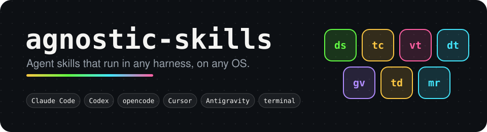

  
  
  
  

**Drop-in skills for coding agents.** Each one is a folder your agent reads, plus small python
scripts that do the repeatable parts, so the model spends its tokens on judgment.

- Works in Claude Code, Codex, opencode, Cursor, Antigravity, or a bare terminal.
- Plain `python3`, standard library only. No pip installs, no network calls.
- Nothing personal baked in: settings come from env vars or a small config file.

Browse the skills on the docs site: **[drawcode.github.io/agnostic-skills](https://drawcode.github.io/agnostic-skills/)**

## Skills

### Keep agent work cheap

<a href="skills/thread-cost/">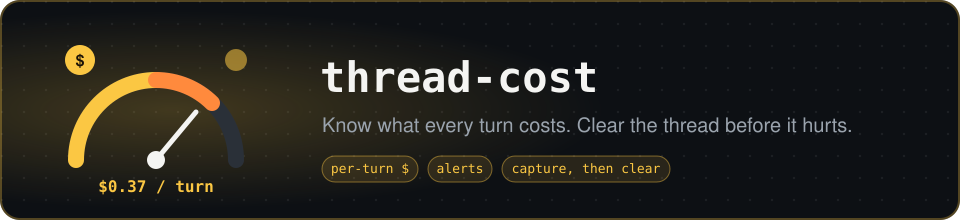</a>
See what each turn costs, get alerts in steps, and hand off before a thread gets expensive.

<a href="skills/tiered-delegation/">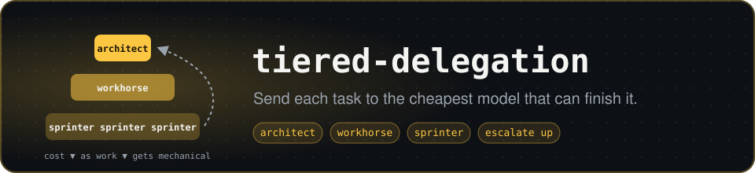</a>
Route each piece of work to the cheapest model tier that can finish it, with lean subagent profiles.

<a href="skills/model-routing/">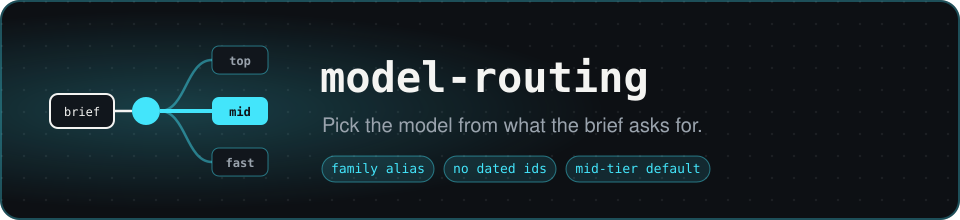</a>
Pick the model for a spawn from its brief, and make a missed `model` land on the mid tier. Install with `tiered-delegation`.

<a href="skills/deterministic-scripts/"></a>
Turn repeatable steps into scripts with one contract, and block secrets and home paths before they commit.

### Test and show your app

<a href="skills/device-testing/"></a>
Install, tap, swipe, screenshot and wait on logs on an attached Android phone or iPhone, with one command set.

<a href="skills/gameplay-verification/">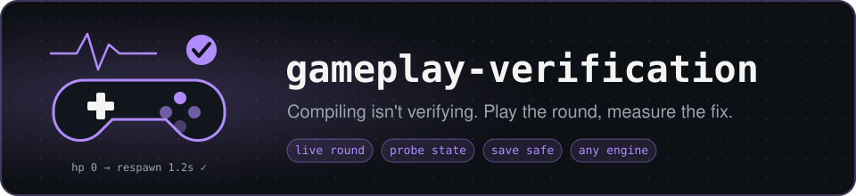</a>
Prove a gameplay fix in a live round, measure it, and keep the player's save safe. Any engine.

<a href="skills/video-trim/">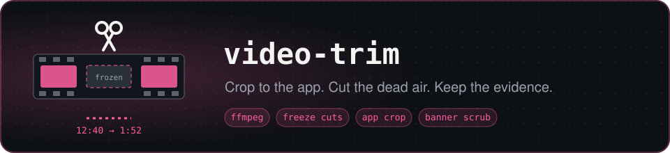</a>
Crop a recording to the app, cut the frozen stretches, scrub notification banners, and join clips with chapters.

More are on the way.

## Install a skill

1. **Copy the folder.** Put `skills/<name>/` where your harness looks for skills, and leave it there
   (hooks call its scripts by absolute path).
2. **Follow its `INSTALL.md`.** Installers report first and change nothing until you pass `--write`.

<b>Where each harness looks for skills</b>

| Harness | Folder |
|---|---|
| Claude Code | `~/.claude/skills/<name>` (all projects) or `<repo>/.claude/skills/<name>` |
| Codex, opencode | `~/.agents/skills/<name>`, or the harness's own skills folder |
| Anything else | Any fixed folder, plus a pointer to its `SKILL.md` in your always-loaded rules (`AGENTS.md`, `GEMINI.md`, and so on) |

<b>What an installer will and won't do</b>

- Reports what it would change, and changes nothing until you pass `--write`.
- Backs up each file it touches.
- Uninstalls cleanly.
- A skill that drives outside tools (ffmpeg, adb, Xcode) lists them in its `INSTALL.md`.

## How they're built

Every skill follows the same few rules. [`AUTHORING.md`](AUTHORING.md) shows how to write your own
the same way.

<b>No personal or machine values</b>

Each skill reads its settings from environment variables, then its own `KEY=value` file
(`~/.config/<skill>/config.env`, or `%APPDATA%\<skill>\config.env` on Windows), then the defaults.
No config file is needed.

<b>State stays outside your repos</b>

State goes in the per-user state folder (`${XDG_STATE_HOME:-~/.local/state}`, or `%LOCALAPPDATA%`
on Windows), never in your project.

<b>Hooks fail silent</b>

A hook that hits an error prints nothing and exits 0, so it never breaks a turn.

<b>Base plus add-on</b>

To tune a skill for your setup without forking it, keep an `addons/<name>.addon.md` beside its
`SKILL.md`. Record only what differs (for example your capture step or where your notes live). The
agent reads the base first, then the add-on, and the add-on wins on conflict.

## Made by

These skills run every day across our studios' app, game and web work.

  <a href="https://drawcode.com">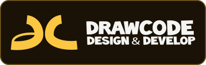</a>&nbsp;
  <a href="https://drawk.com">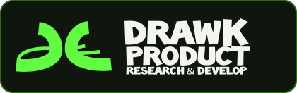</a>&nbsp;
  <a href="https://drawlabs.com">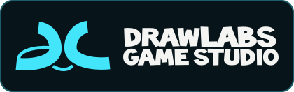</a>

[drawcode.com](https://drawcode.com) · [drawk.com](https://drawk.com) · [drawlabs.com](https://drawlabs.com) · [Docs site](https://drawcode.github.io/agnostic-skills/)

## License

[MIT](LICENSE)
