<p align="center"></p>

**Moves repeatable steps out of model tokens into scripts, and keeps personal values and secrets out of prompts and commits.**

- Counts, greps and parsing run as scripts, so the answer is the same every time.
- Machine and personal values live in one home config file, never in a prompt or a repo.
- A pre-commit guard blocks leaks before they land.

## Quick start

1. Copy the folder into your project or skills folder: [install a skill](../../README.md#install-a-skill).
2. Run the self-test (`<scripts>` is the kit's `scripts/` folder):

   ```sh
   python3 <scripts>/test_scripting.py
   ```

3. Find commands you keep repeating:

   ```sh
   python3 <scripts>/repeat_scan.py <transcript or history>
   ```

## What's inside

| Script / file | What it does |
|---|---|
| `SKILL.md` | The rules as a skill |
| `prompt-deterministic-scripts.md` | The same rules as one paste-ready block, for harnesses without skills |
| `references/script-contract.md` | The script contract and what the linter checks |
| `references/config-convention.md` | Home config file: location, format, key naming, extra scan patterns |
| `scripts/homecfg.py` | Reads the home config (`get`, `keys`, `path`, `check`, `where`); python import too |
| `scripts/new_script.py` | Scaffolds a script that already meets the contract and indexes it |
| `scripts/check_scripts.py` | Lints scripts against the contract |
| `scripts/repeat_scan.py` | Finds repeated commands in a transcript or shell history |
| `scripts/scan_sensitive.py`, `scrub_sensitive.py` | Find and fix personal values and secrets |
| `scripts/install_hooks.py`, `scripts/hooks/pre-commit` | The commit guard |
| `scripts/test_scripting.py` | Self-test |

## How it works

Before each task the agent spots steps with a fixed answer and runs or writes a script for them. New scripts start from a scaffold that meets the contract. Values a script needs come from your home config at run time.

<details>
<summary><b>The script contract</b></summary>

- Stdlib `python3` (3.9+); shell only with a stated `portability-exception`.
- Header doc, `--help`, `--json`.
- Exit `0` ok, `1` failed, `2` bad input.
- Read-only unless `--write`.
- Indexed in the nearest `README.md` `## Index`.
- Full list: `references/script-contract.md`.

</details>

<details>
<summary><b>Home config</b></summary>

- Default file: `~/.config/deterministic-scripts/config.env` (`%APPDATA%\deterministic-scripts` on Windows).
- Override with `DETERMINISTIC_SCRIPTS_CONFIG` (a file) or `DETERMINISTIC_SCRIPTS_HOME` (a folder).
- Read a key with `python3 <scripts>/homecfg.py get <key>` or `homecfg.get("<key>")`.
- Extra scan patterns: `patterns.txt`, `pattern_*` keys, or `DETERMINISTIC_SCRIPTS_PATTERNS` / `DETERMINISTIC_SCRIPTS_LITERALS`.
- Details: `references/config-convention.md`.

</details>

<details>
<summary><b>The commit guard</b></summary>

- `hooks/pre-commit` scans every line a commit adds: home paths, emails, private keys, tokens, `password=`/`secret=` assignments, and every value in your config.
- A hit stops the commit. Fix it with `scrub_sensitive.py <dir> --write` or move the value to the config.
- Install per clone with `install_hooks.py <repo> --write`. It reports first and changes nothing without `--write`.
- It refuses (exit 2) if the repo already has other hooks.
- `.sensitive-allow` takes public or fake values only.

</details>

<details>
<summary><b>Safety and uninstall</b></summary>

- Scripts never echo a secret; scan hits print redacted.
- Pushed history is not rewritten: rotate any secret that leaked.
- Uninstall: `install_hooks.py <repo> --uninstall --write` in each repo, then delete the kit folder, the harness link and the pasted block.
- The home config is yours; nothing else is written.

</details>

<details>
<summary><b>Harness support</b></summary>

- Claude Code: link the folder as a skill and `@`-import the prompt block.
- opencode / Codex CLI: name the prompt block in `AGENTS.md`.
- Cursor / IDE agents: an always-apply rule pointing at the prompt block.
- Raw API: put the block in the orchestrator system prompt.

</details>

## Files

- [`SKILL.md`](SKILL.md): what the agent reads
- [`INSTALL.md`](INSTALL.md): full install and uninstall
- [`prompt-deterministic-scripts.md`](prompt-deterministic-scripts.md): the rules as one paste-ready block
- [`references/`](references/): script contract and config convention

<sub>Part of <a href="../../README.md">agnostic-skills</a> · MIT</sub>
