<p align="center"></p>

**Drive an attached Android phone or iPhone from the terminal with one `device` command set, and prove every action worked.**

- Same commands on Android and iOS: install, launch, tap, swipe, type, screenshot, record.
- Taps are proven by a log line, not by exit code 0.
- Knows no app: your config, profile and add-ons carry the specifics.

## Quick start

1. Copy the folder into your harness: [install a skill](../../README.md#install-a-skill).
2. Set your app ids, then list devices:

   ```sh
   cp config.example.env ~/.config/device-testing/config.env   # set APP_ANDROID_PACKAGE, APP_IOS_BUNDLE_ID
   python3 <skill>/scripts/device.py devices
   ```

3. Try a check, a screenshot and a proven tap:

   ```sh
   D=<skill>/scripts/device.py
   python3 $D check
   python3 $D shot
   python3 $D tap 540 1200 --wait 'Opened.*Menu'
   ```

## What's inside

| Script / file | What it does |
|---|---|
| `scripts/device.py` | The `device` CLI: one command set for an attached Android phone or iPhone |
| `scripts/ios-sim-harness.py` | iOS simulator harness: build a tiny UIKit harness around plugin `.mm` files and drive it |
| `scripts/device_tap_nudge.py` | PostToolUse (Bash) hook: nudges toward a plan or the device-runner after N single device inputs in a row |
| `scripts/device_testing/ios_recorder.py` | iOS screen recording helper used by `device.py record` |
| `scripts/device_testing/` | Per-platform backends (Android, iOS, iOS hid/WDA/media), plans, nav profiles |
| `scripts/ios_media_helper/` | Xcode project for the iOS Photos helper behind `device media` |
| `agents/device-runner.md` | Subagent profile that runs a whole device pass and returns a verdict and evidence paths |
| `references/` | Command matrix, every command's arguments, capture, plans, iOS, simulator, extending |
| `config.example.env` | Every config key, commented |

## How it works

`device` routes each command to the attached phone's platform. You run a flow as one `device run <plan>` call instead of one input per turn.

State comes from logs (`log`, `wait <regex>`, `nav <id>`). Screenshots are evidence: `shot` also writes a small copy to read.

<details>
<summary><b>Configuration</b></summary>

Copy `config.example.env` to `~/.config/device-testing/config.env`, or point `DEVICE_TESTING_CONFIG` elsewhere. Every key can come from the environment. Never commit a filled-in copy.

| Key | Default | Meaning |
|---|---|---|
| `APP_ANDROID_PACKAGE`, `APP_IOS_BUNDLE_ID` | empty | Your app ids (set at least these) |
| `DEVICE_<ALIAS>_SERIAL` | none | Optional device alias; on iOS the serial is the UDID |
| `DEVICE_IOS_INPUT` | `auto` | `hid` on iOS 27+, else `server`; or force one |
| `DEVICE_IOS_RECORD` | `auto` | `capture`, `stream`, `shots`, or auto fallback |
| `SHOT_MAX_HEIGHT` | `1000` | Height of the small screenshot copy; `0` = full size only |
| `DEVICE_QUIET_REQUIRED` | unset | `1` makes `preflight` and `record start` fail if notifications are not silenced |
| `SCRATCH_ROOT` | system temp dir | Where shots, video and logs go |
| `DEVICE_TESTING_ADDONS` | empty | `:`-separated add-on modules |

More keys (log buffer, symbol files, prefs files, input server, WDA) are in `config.example.env`.

</details>

<details>
<summary><b>Platform requirements</b></summary>

- `python3` 3.9+, standard library only.
- Android: `adb` on PATH, USB debugging on, host authorized.
- iOS: Xcode (`xcrun devicectl`), `pymobiledevice3`, iPhone paired over USB with Developer Mode on and "Trust This Computer" accepted.
- iOS `record`: `ffmpeg`. Full rate needs Camera access for the terminal's app, else about 5 fps screenshots.
- Optional: Pillow (small copies, contact sheets), `idb` (simulator harness only).

</details>

<details>
<summary><b>iOS input</b></summary>

- iOS 27+: taps go through the host (`hid`).
- Older iOS, or when host taps fail: the app needs an in-app input server.
- It is a loopback HTTP endpoint, started only when an environment variable is set, kept out of release builds.
- Connect with `device launch --input-server`, then `device forward`.
- Protocol: [`references/input-server.md`](references/input-server.md).

</details>

<details>
<summary><b>Optional Claude Code extras</b></summary>

- Runner subagent: copy or symlink `agents/device-runner.md` into `~/.claude/agents/`.
- Tap-nudge hook: a PostToolUse hook on `Bash` that only prints a hint after 3 single inputs in a row. It never blocks.
- Tune it with `DEVICE_TAP_NUDGE_EVERY` and `DEVICE_TAP_NUDGE_CLI`. Setup is in [`INSTALL.md`](INSTALL.md).

</details>

<details>
<summary><b>Safety and uninstall</b></summary>

- The runner never installs a build it was not told to, clears app data or posts anywhere.
- Scratch output stays under `SCRATCH_ROOT`; nothing is written elsewhere.
- Stop the app after a pass (a running game heats the phone).
- Uninstall: delete the folder and `~/.config/device-testing/`.

</details>

## Files

- [`SKILL.md`](SKILL.md): what the agent reads
- [`INSTALL.md`](INSTALL.md): full install and uninstall
- [`agents/device-runner.md`](agents/device-runner.md): subagent profile for a whole device pass
- [`references/`](references/): command matrix, commands, capture, plans, iOS, simulator, extending

<sub>Part of <a href="../../README.md">agnostic-skills</a> · MIT</sub>
