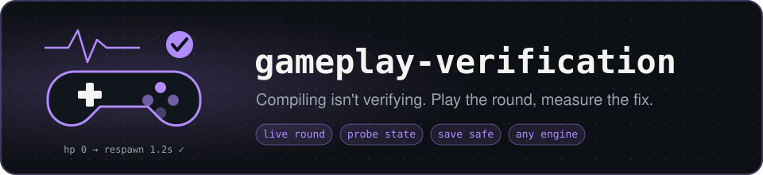

<p align="center"></p>

**Verify a gameplay fix by driving a live round into the failing state and measuring the change, not by reasoning that it compiles.**

- Pins a reproduction first, then fixes, then re-runs the same probe to show it moved.
- Protects the player's save and any live setting another session is editing.
- Ends with a report of what was and was not exercised.

## Quick start

1. Copy the folder into your harness: [install a skill](../../README.md#install-a-skill).
2. Write an engine add-on and a game add-on in `addons/` beside `SKILL.md` (templates in [`INSTALL.md`](INSTALL.md)).
3. Before you report a fix, ask the agent:

   ```text
   Before reporting this gameplay fix, read gameplay-verification/SKILL.md and its add-ons, then drive a live round and show the measurement changed.
   ```

## What's inside

This skill ships no scripts and has no dependencies.

| Script / file | What it does |
|---|---|
| `SKILL.md` | The rules the agent follows, engine-agnostic |
| `INSTALL.md` | Install steps and the two add-on templates |
| `addons/<engine>.addon.md` | You write it: how to run probes in your engine |
| `addons/<game>.addon.md` | You write it: how to reach and measure a round of your game |

## How it works

The base rules know no engine and no game. They tell the agent what to check.

Your add-ons tell it how to reach that in your project. The agent reads the base, then the engine add-on, then the game add-on. The later file wins on conflict.

<details>
<summary><b>What the rules cover</b></summary>

- Reach a real round, and name what a scripted shortcut skips.
- Protect the save before probing.
- Probe state and call the code under test directly.
- Measure on screen before believing a diagnosis.
- Combat and actors: pin the player, re-resolve targets, disclose every pin.
- State is not a screenshot: say "verified by state, not seen".
- Shared editor or live tree: ask peers first, restore by path.
- Leave it as you found it, and report.

</details>

<details>
<summary><b>Add-ons</b></summary>

- Engine add-on: probe channel, play that keeps ticking, frame hooks, input injection, rendering traps.
- Game add-on: start a round, the "playing" flag, mode, save location and live settings, event bus and HUD.
- Each add-on records only the delta and cites `SKILL.md` for the rest.

</details>

<details>
<summary><b>Safety</b></summary>

- A half-booted session holds defaults. Compare saved values in memory against disk before any probe that may write.
- Take a fresh save backup per session.
- Never restore live settings another session may edit. Diff first and copy back only what you changed.
- Nothing is installed beyond the folder.

</details>

<details>
<summary><b>Platform and harnesses</b></summary>

- Any engine, any OS. No scripts, no dependencies.
- Claude Code, Codex, opencode, or any harness with a pointer to `SKILL.md` in its always-loaded rules.

</details>

<details>
<summary><b>Limits</b></summary>

- It cannot reach your engine or game without add-ons.
- A scripted round may draw nothing: state readings are not evidence of what is on screen.
- It pairs with a device-driving skill (for example `device-testing`) when the round has to run on a phone.

</details>

## Files

- [`SKILL.md`](SKILL.md): what the agent reads
- [`INSTALL.md`](INSTALL.md): full install and uninstall

<sub>Part of <a href="../../README.md">agnostic-skills</a> · MIT</sub>
