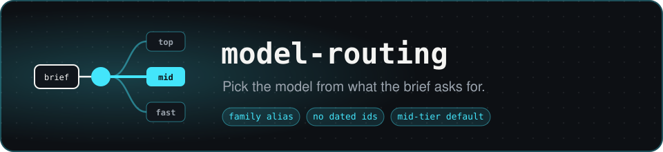

<p align="center"></p>

**Picks the right model for every subagent spawn that has no pinned profile, so a missed `model` never runs on a frontier driver's rate.**

> Installed together with [`tiered-delegation`](../tiered-delegation/), which decides whether to delegate and defines the lean profiles. This skill decides which model runs the rest.

- Newest model by family alias (`haiku` / `sonnet` / `opus`), never a dated id.
- Workhorse (mid tier) is the floor for anything un-modelled.
- Sprinter (small tier) for pure mechanics, with no judgment in the brief.

## Quick start

1. Copy the folder (and `tiered-delegation` beside it): [install a skill](../../README.md#install-a-skill).
2. Set the harness default. On Claude Code, add this to `~/.claude/settings.json`, then start a new session:

   ```json
   "env": {"CLAUDE_CODE_SUBAGENT_MODEL": "sonnet"}
   ```

3. Try the picker:

   ```sh
   python3 <skill>/scripts/pick_model.py --task "grep every caller of Foo and count them"
   ```

## What's inside

| Script / file | What it does |
|---|---|
| `SKILL.md` | When to pick, the tiers, harness wiring per harness, what not to set |
| `references/context-claude-code-subagent-model.md` | How Claude Code resolves a subagent's model, and how to re-verify after an upgrade |
| `scripts/pick_model.py` | Classifies a brief as sprinter / workhorse / architect and prints the model alias (or role with `--harness any`) |
| `scripts/pick_agent.py` | The leanest profile for a kind of work; extra tools register in a profiles file (`--help`) |
| `scripts/test_pick_model.py` | The classifier's regression briefs |

## How it works

The picker reads the brief you are about to send and looks at its verbs. One judgment verb keeps it at workhorse. No signal means workhorse.

It prints `MODEL: <alias> tier=<tier> does=<kind> agent=<profile>`. Spawn that profile when it exists, otherwise pass `model=<alias>`.

<details>
<summary><b>Harness wiring</b></summary>

| Harness | Default subagent model |
|---|---|
| Claude Code | `"env": {"CLAUDE_CODE_SUBAGENT_MODEL": "sonnet"}` in user `settings.json` |
| opencode | `agent.general.model` in `opencode.json`, set to the provider's mid "latest" model |
| Codex / Cursor / IDE agents | the tool's subagent or background-agent model setting, set to its mid model |
| Own loop / raw API | the spawn tool's `model` argument defaults to the mid alias |

Env changes and new agent files load at session start.

</details>

<details>
<summary><b>Claude Code precedence</b></summary>

Verified against v2.1.314:

1. A `model` on the call.
2. The agent's frontmatter `model`.
3. `CLAUDE_CODE_SUBAGENT_MODEL`.
4. The parent's model.

The default changes only un-modelled spawns. Pinned profiles and explicit `opus` calls keep their model.

</details>

<details>
<summary><b>What not to set</b></summary>

- `CLAUDE_CODE_SUBAGENT_MODEL_FORCE`: it also overrides explicit picks, so an architect call would silently run on the default.
- `CLAUDE_CODE_WORKFLOW_SUBAGENT_MODEL`: it overrides every workflow `agent()` model.
- A hook that rewrites or denies the spawn's `model`: some session modes refuse a call a hook changed, and a denial makes the driver rewrite the whole brief.

</details>

<details>
<summary><b>Tool agents in pairs</b></summary>

An agent that drives one tool (an engine Editor, a device, a browser) works best split in two:

- **runner** (sprinter): runs the exact commands the brief gives and returns the output. Failures that need judgment come back `BLOCKED`.
- **operator** (workhorse): diagnosis, new probes, deciding what to run next.

Register both with `pick_agent.py` so `--needs <tool>` routes by kind.

</details>

<details>
<summary><b>Requirements and limits</b></summary>

- Stdlib `python3` (3.9+), read-only, no network. Each script takes `--help` and `--json`.
- `--harness any` prints a role (`small` / `mid` / `strongest`) for a non-Claude harness to map.
- Architect is never a default. It is picked per spawn.

</details>

## Files

- [`SKILL.md`](SKILL.md): what the agent reads
- [`INSTALL.md`](INSTALL.md): full install and uninstall
- [`references/context-claude-code-subagent-model.md`](references/context-claude-code-subagent-model.md): evidence and re-verification

<sub>Part of <a href="../../README.md">agnostic-skills</a> · MIT</sub>
