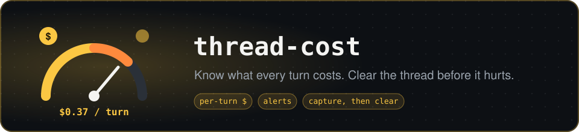

<p align="center"></p>

**Shows what each agent turn costs and has the model write a handoff before a thread gets expensive.**

- A cost line after every reply, from the harness's own transcript.
- Alerts every $5, and a capture block at $15 or a large context.
- You clear the thread and continue from the handoff, so you stop paying for old context.

## Quick start

1. Copy the folder to a place it will stay: [install a skill](../../README.md#install-a-skill).
2. Wire the hooks (`<skill>` is this folder):

   ```sh
   python3 <skill>/scripts/thread_hooks_install.py --write
   ```

3. Check it reads your session:

   ```sh
   python3 <skill>/scripts/thread_cost_alert.py status
   ```

## What's inside

| Script / file | What it does |
|---|---|
| `scripts/thread_cost_alert.py` | Cost line, alerts, capture block; `status` / `check` / `replay` |
| `scripts/thread_idle_capture.py` | Idle wake before the prompt cache lapses (Claude Code) |
| `scripts/thread_handoff.py` | Records the handoff; resumes from it after `/clear` or `/compact` |
| `scripts/thread_hook_antigravity.py` | Antigravity hook adapter |
| `scripts/thread_usage.py` | Reads Claude Code, opencode, Codex and Antigravity sessions: time, tokens, cost |
| `scripts/model_prices.json` | Price table (USD per million tokens, with an `as_of` date) |
| `scripts/thread_hooks_common.py` | Shared config and state helpers |
| `scripts/thread_hooks_install.py` | Wires, checks and removes the hooks |

## How it works

Every request re-reads the whole conversation, so a long thread pays for its past on every step. The hooks read the transcript, estimate cost, and at a threshold ask the model to write a handoff. You then clear and continue from it.

<details>
<summary><b>What fires and when</b></summary>

| Trigger | Does |
|---|---|
| Every prompt | Gives the model last turn's cost to end the reply with (off with `thread_turn_cost_line=0`) |
| Every $5 | Alert on screen and to the model |
| Live context 200K | One on-screen note |
| $15 (then every $15), or context 300K (then every 100K) | Blocks the stop once with the capture instruction |
| Context 40K past the session start (then every 40K) | Same capture block; skipped for subagents |
| SessionStart after `clear` or `compact` | Tells the new session to read the recorded handoff first |
| Resume after the cache lifetime on context over 100K | One-line note suggesting a handoff and a clear |
| 50 min idle (cost >= $1, context >= 60K) | Wakes the thread once to capture while the cache is warm |

</details>

<details>
<summary><b>Configuration keys</b></summary>

All optional. Environment wins, then `~/.config/thread-cost/config.env`, then the default.

| Key | Default | Meaning |
|---|---|---|
| `thread_cost_alert_usd` / `thread_cost_alert_step_usd` | 5 / 5 | first alert, then every step |
| `thread_cost_capture_usd` / `thread_cost_capture_step_usd` | 15 / 15 | cost capture |
| `thread_ctx_capture_k` / `thread_ctx_step_k` | 300 / 100 | context capture (K tokens) |
| `thread_ctx_growth_k` | 40 | growth capture; 0 = off |
| `thread_idle_capture_min` | 50 | idle wake; keep under the 1h cache TTL |
| `thread_turn_cost_line` | 1 | 0 = no per-turn cost line |
| `thread_capture_step` / `thread_capture_step_file` | built in | the capture step, as one line or a text file |

Full list: `SKILL.md`, Config.

</details>

<details>
<summary><b>Harness support</b></summary>

| Harness | Cost line, alerts, capture | Idle wake, resume after clear |
|---|---|---|
| Claude Code | automatic (hooks) | automatic |
| Antigravity | automatic once a conversation has token data | no |
| opencode, Codex, Cursor, a bare terminal | manual: run `status` at iteration boundaries | no |

</details>

<details>
<summary><b>Hooks and what they change</b></summary>

- Claude Code: five hooks merged into `settings.json`.
- Antigravity: one `thread-cost` hook in `config/hooks.json`, when `~/.gemini` exists.
- Your other hooks are kept and each file is backed up first.
- Any hook failure prints nothing and exits 0, so a hook never breaks a turn.

</details>

<details>
<summary><b>Limits and safety</b></summary>

- Cost is an API list-price estimate; a subscription bills differently, so read it as relative size.
- Scripts are read-only towards the harness and use no network, except the optional Antigravity local server on 127.0.0.1.
- State lives outside every repo.
- Uninstall: `python3 <skill>/scripts/thread_hooks_install.py --uninstall --write`, then delete the folder.

</details>

## Files

- [`SKILL.md`](SKILL.md): what the agent reads
- [`INSTALL.md`](INSTALL.md): full install and uninstall
- [`config.example.env`](config.example.env): every config key, commented

<sub>Part of <a href="../../README.md">agnostic-skills</a> · MIT</sub>
