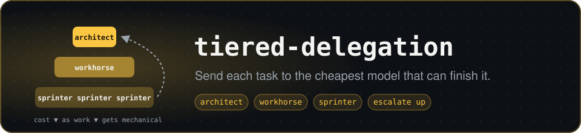

<p align="center"></p>

**Routes each unit of agent work to the cheapest model tier that can finish it, and does the routing and cost math in scripts, not in the model.**

> Installed together with [`model-routing`](../model-routing/), which picks the model for any spawn that has no pinned profile and sets the harness default.

- Three tiers: architect, workhorse, sprinter. You spend the savings on coverage, not a bigger model.
- A per-prompt check decides inline or delegate, and an escalation protocol handles stuck agents.
- Lean subagent profiles load 4.8k-8.2k tokens instead of ~37.5k for a generic agent.

## Quick start

1. Copy the folder (and `model-routing` beside it): [install a skill](../../README.md#install-a-skill).
2. Run the estimator once to confirm it works:

   ```sh
   python3 <repo>/.claude/skills/tiered-delegation/scripts/estimate_delegation.py --tokens 20000
   ```

3. Start a session and ask what skills it has. `tiered-delegation` should be listed. It triggers on multi-step work.

## What's inside

| Script / file | What it does |
|---|---|
| `SKILL.md` | The rules as a skill |
| `prompt-tiered-delegation.md` | The same rules as one paste-ready block, for harnesses without skills |
| `references/` | Mini plan template, escalation format, and the rationale, script contracts and A/B benchmark behind the rules |
| `scripts/estimate_delegation.py` | Prints `VERDICT: delegate\|inline` from payload size vs agent overhead |
| `scripts/pick_agent.py` | Maps what a unit of work does and needs to the leanest profile; extra tools register in a profiles file (`--help`) |
| `scripts/tally_cost.py` | Sums real token and cost per session, compares a delegated run to an inline one, measures each agent type's fixed context (`--agent-overhead`) |
| `agents/*.md` | Lean subagent profiles (runner, scout, sprinter, workhorse, architect): pinned model, minimal tools, no CLAUDE.md, no spawn tool |

## How it works

Each prompt, the driver estimates whether delegating beats doing it inline. Below about 6k tokens of agent overhead, inline wins.

Work that fits goes to the cheapest capable tier, in one batched brief. A stuck agent returns a `BLOCKED` block and the question is promoted up.

<details>
<summary><b>The tiers</b></summary>

- **Architect:** strongest reasoning model, read-only. Ambiguous scope, root cause, plans, final review.
- **Workhorse:** solid mid model. Implementation that needs judgment about surrounding code.
- **Sprinter:** small, fast model. Pure extraction and mechanical edits with the target named.

Measured: the small tier on judgment scored 1.35 vs 1.86 inline. The mid tier held at 1.91 vs 1.98.

</details>

<details>
<summary><b>Scripts</b></summary>

- Stdlib `python3` (3.9+), read-only, no network.
- Each takes `--help` and `--json`.
- Exit `0` is ok, `2` is bad input.

</details>

<details>
<summary><b>Harnesses</b></summary>

| Harness | Rules go in | How a subagent gets its tier |
|---|---|---|
| Claude Code | `<repo>/CLAUDE.md` or `AGENTS.md` | `Agent` tool, `model: opus \| sonnet \| haiku` per spawn |
| opencode | `<repo>/AGENTS.md` | one subagent per tier in `opencode.json`, each with a pinned `model` |
| Codex CLI | `<repo>/AGENTS.md` | its subagent or model-selection feature; with none, the loop, scripts and escalation still apply |
| Cursor / IDE agents | an always-apply project rule, or `AGENTS.md` | the tool's model picker or background-agent model |
| Raw API / own loop | the orchestrator's system prompt | a spawn tool with a `model` argument |

Details and skill locations: [`INSTALL.md`](INSTALL.md).

</details>

<details>
<summary><b>Safety and uninstall</b></summary>

- The scripts are read-only and touch no network.
- To uninstall, delete the skill folder (or its link) and the pasted block. Nothing else is written anywhere.
- Prefer project scope over a global instructions file, which every other project shares.

</details>

<details>
<summary><b>Limits</b></summary>

- Driver session only. A spawned subagent never uses it and never spawns another.
- Terse briefs on trivial work can get refused as suspected prompt injection.
- On non-Claude models, map tiers by role and A/B the small tier before trusting it past pure extraction.

</details>

## Files

- [`SKILL.md`](SKILL.md): what the agent reads
- [`INSTALL.md`](INSTALL.md): full install and uninstall
- [`prompt-tiered-delegation.md`](prompt-tiered-delegation.md): paste-ready rules block
- [`references/`](references/): templates, protocol and evidence
- [`agents/`](agents/): the lean subagent profiles

<sub>Part of <a href="../../README.md">agnostic-skills</a> · MIT</sub>
