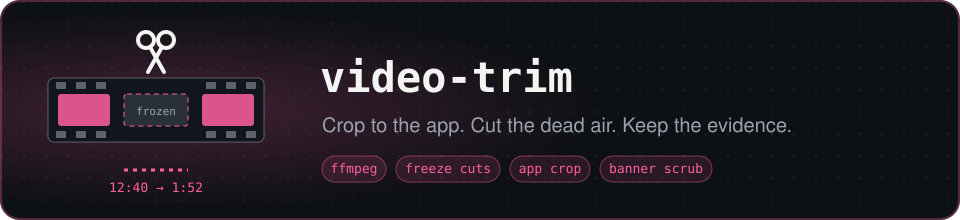

<p align="center"></p>

**Cut the dead time out of a screen recording, crop it to the app, and hand over a short video that still lines up with your logs.**

- A 365 s capture that was 293 s frozen came out at 84 s and 7 MB.
- Crops away the desktop, chat and file names, so only the app is shared.
- Cuts notification banners (payment, doorbell, message) before anyone sees them.

## Quick start

1. Copy the folder into your harness: [install a skill](../../README.md#install-a-skill).
2. Check the tools are found:

   ```sh
   ffmpeg -version && ffprobe -version
   ```

3. Trim a recording:

   ```sh
   python3 <skill>/scripts/trim.py video/run.mp4   # -> video/run-trimmed.mp4 + .trimmap.txt
   ```

## What's inside

| Script / file | What it does |
|---|---|
| `scripts/app_crop.py` | Find the app's rectangle in a larger capture and crop to it |
| `scripts/trim.py` | Cut frozen stretches, keep a beat at each edge |
| `scripts/cut_windows.py` | Keep explicit or log-driven windows |
| `scripts/scrub_overlays.py` | Cut notification banners (OCR; `ocr_frames.swift` is the macOS Vision helper) |
| `scripts/ocr_frames.swift` | macOS Vision OCR helper behind `scrub_overlays.py --ocr vision` |
| `scripts/side_by_side.py` | Slowed before/after of a sub-second effect |
| `scripts/frame_strip.py` | Contact sheet to check a cut |
| `scripts/stitch.py` | Join recordings into one review video with chapters |
| `config.example.env` | Optional settings, commented |

## How it works

Order: scrub, then crop and trim (one encode), then check a frame strip, then stitch if you need one file.

Every script writes a new file and refuses to overwrite without `--force`. The trimmed copy carries a source-time subtitle track and a segment map, so a moment in the short video matches a log line.

<details>
<summary><b>Crop to the app</b></summary>

- On by default in `trim.py` and `cut_windows.py`. The verdict is printed and written to the trimmap or segments file.
- An app-only phone recording is detected and left alone.
- Unclear cases (two windows, a lone small animation) exit `3` and never guess. Pass `--crop W:H:X:Y` or `--no-crop`.
- Look at `<out>.crop-before.png` and `<out>.crop-after.png` before sharing.
- Keep the full frame only when the surroundings are the evidence, and say so.

</details>

<details>
<summary><b>Configuration</b></summary>

| Key | Default | Meaning |
|---|---|---|
| `VIDEO_TRIM_CROP` | `auto` | `off` keeps the full frame by default; `--crop` still works |
| `VIDEO_TRIM_CACHE` | `~/.cache/video-trim` | Folder for the compiled macOS OCR helper |

Set them in the environment or in `~/.config/video-trim/config.env`. The environment wins.

</details>

<details>
<summary><b>Requirements</b></summary>

- `python3` 3.9+, standard library only.
- `ffmpeg` and `ffprobe` on PATH.
- OCR for `scrub_overlays.py` only: macOS Vision (needs `swiftc`) or `tesseract` on any OS.
- No network access.

</details>

<details>
<summary><b>Safety and uninstall</b></summary>

- Inputs are never modified, except `scrub_overlays.py --in-place` (the source is the leak).
- Nothing is written outside the outputs you name and the OCR cache folder.
- No hooks to remove. Delete the skill folder and the cache folder.
- Keep the original until the work is done.

</details>

<details>
<summary><b>Limits and traps</b></summary>

- A held result screen is cut to about 0.6 s. Use `cut_windows.py` when it is the evidence.
- A small idle animation or an animated background can defeat freeze detection.
- Do not trim a timing capture.
- Say in the hand-over that the video is trimmed and cropped.
- Write `<name>.start` when recording starts, or a cut video cannot be lined up with a log.
- Tesseract is less proven than Vision on real banners: dry-run first.

</details>

## Files

- [`SKILL.md`](SKILL.md): what the agent reads
- [`INSTALL.md`](INSTALL.md): full install and uninstall
- [`config.example.env`](config.example.env): settings template

<sub>Part of <a href="../../README.md">agnostic-skills</a> · MIT</sub>
